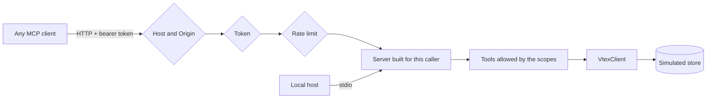

# mcp-ecommerce-server

An MCP server that gives any AI agent catalog, inventory and order tools for a store, over a simulated API in VTEX's format. Each token decides which tools exist, and customers can only reach their own orders.

**[Live panel](https://mcp-ecommerce-server.vercel.app)**: switch tokens and watch the same agent gain or lose tools, with every MCP call on screen.

Project 7 of a 12-project AI engineering track focused on front-end. The panel is in Portuguese. All people, addresses and orders are fake, and this project has no link to VTEX.

## Use it

**In Claude Desktop, Claude Code or Cursor** (local, over stdio):

```json
{
  "mcpServers": {
    "store": {
      "command": "npx",
      "args": ["-y", "mcp-ecommerce-server"]
    }
  }
}
```

**Try the tools by hand:**

```bash
npx @modelcontextprotocol/inspector npx -y mcp-ecommerce-server
```

**Over the web,** at `https://mcp-ecommerce-server.vercel.app/api/mcp` with a bearer token. These demo tokens are public because they only reach fake data:

| Token | Sees |
| --- | --- |
| `demo-catalog-only` | The catalog |
| `demo-customer-ana` | The catalog and one customer's orders |
| `demo-support-agent` | The catalog, inventory and every order |

```bash
curl -X POST https://mcp-ecommerce-server.vercel.app/api/mcp \
  -H "Authorization: Bearer demo-catalog-only" \
  -H "Content-Type: application/json" \
  -H "Accept: application/json, text/event-stream" \
  -d '{"jsonrpc":"2.0","id":1,"method":"tools/list"}'
```

## What it exposes

| Kind | Name | Scope | What it does |
| --- | --- | --- | --- |
| Tool | `search_products` | `catalog:read` | Search with a price and stock filter |
| Tool | `get_product` | `catalog:read` | One product's details |
| Tool | `check_inventory` | `inventory:read` | Units per warehouse |
| Tool | `list_orders` | `orders:read:own` or `:all` | Recent orders |
| Tool | `get_order` | `orders:read:own` or `:all` | Status, items and tracking |
| Resource | `store://policies/shipping-and-returns` | `catalog:read` | The store's rules |
| Prompt | `order_update_message` | `orders:read:own` or `:all` | Draft a message to the customer |

Every tool is read-only.

## How access works



The rules are enforced by the server, never by asking the model, because text returned by a tool can try to instruct the model.

- **A tool outside the token's scopes does not exist for that client.** It is not listed, and it cannot be called by name.
- **The customer filter comes from the token.** A customer's `list_orders` has no `customerEmail` parameter, and one sent anyway is ignored.
- **"Not yours" and "does not exist" get the same answer,** so order ids cannot be probed.
- **Personal data never reaches the model.** CPF, phone, e-mail, last name and street address are removed before responding. What a model never receives, it cannot leak.
- **Customer-written text is labeled.** The field is called `untrustedCustomerNote`, and one test order carries a prompt injection in it. The label only lowers the risk: the real protection is that, even if the agent obeyed, the token limits what it can reach and no tool changes anything.
- **Tokens are compared as hashes in constant time,** and the environment stores only the hashes.
- **Rate limits** apply per token, and per address on failed logins, which slows down token guessing.

## Decisions

- **SDK v2, not v1.** v1 is now the maintenance line and does not implement the 2026-07-28 spec. v2 also answers clients on the 2025 protocol from the same code.
- **Stateless over HTTP.** A fresh server per request fits serverless hosting, and it is also what makes per-caller tools simple.
- **`VtexClient` as the seam.** The tools do not know the data is simulated. Fixtures use the real response shapes, including OMS values in cents and the API's own `commertialOffer` spelling, so a real account would implement one interface.
- **A small npm package.** Next.js, React and the AI SDK are dev dependencies used by the panel, so people who install the server only get the MCP SDK and Zod.
- **The panel's agent is an ordinary MCP client.** It uses the same token, checks and protocol as anyone outside. Only the network hop is skipped.

## Limits

- **Static tokens, not OAuth.** They suit system-to-system use, but not end users authorizing an app.
- **In-memory rate limits, per instance.** On serverless hosting, each instance counts on its own. Production would need Redis or similar.
- **Read-only.** Writing needs human confirmation and idempotency, which is the next project's subject.
- **Never run against a real VTEX account.** The response shapes were written from knowledge of the APIs and cover only the fields used here.
- **Simple catalog search.** Every word must match. Search quality was [project 6](https://github.com/Flaviohorbach/semantic-catalog-search).
- **The panel depends on Gemini's free tier,** which is often overloaded. The MCP server itself calls no model and is not affected.

## Run the project

Requires Node 22 or later. Only the panel needs a free [Gemini API key](https://aistudio.google.com/apikey).

```bash
npm install
cp .env.example .env.local   # add GEMINI_API_KEY
npm run dev
```

```bash
npm test               # a real MCP client against the real endpoint, no API needed
npm run build:bin      # build the npm package
npm run test:package   # start it over stdio, as npx would
npm run eval           # agent checks, spends model quota
```

To replace the public demo tokens, set `MCP_TOKENS` as described in [`.env.example`](.env.example).

## Built with AI

Written with a coding agent. [`docs/AI-LOG.md`](docs/AI-LOG.md) records what it got wrong, and [`docs/CONCEITOS.md`](docs/CONCEITOS.md) is a study guide in Portuguese.

## License

MIT for the code. Product data and photos come from [DummyJSON](https://dummyjson.com).
